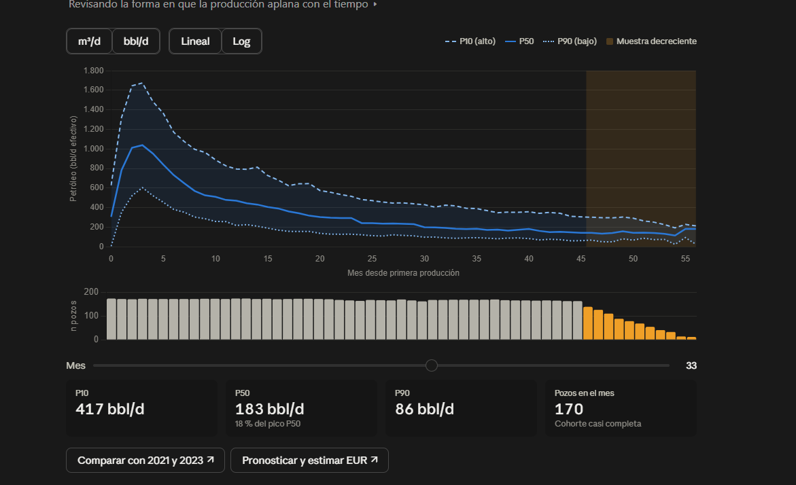
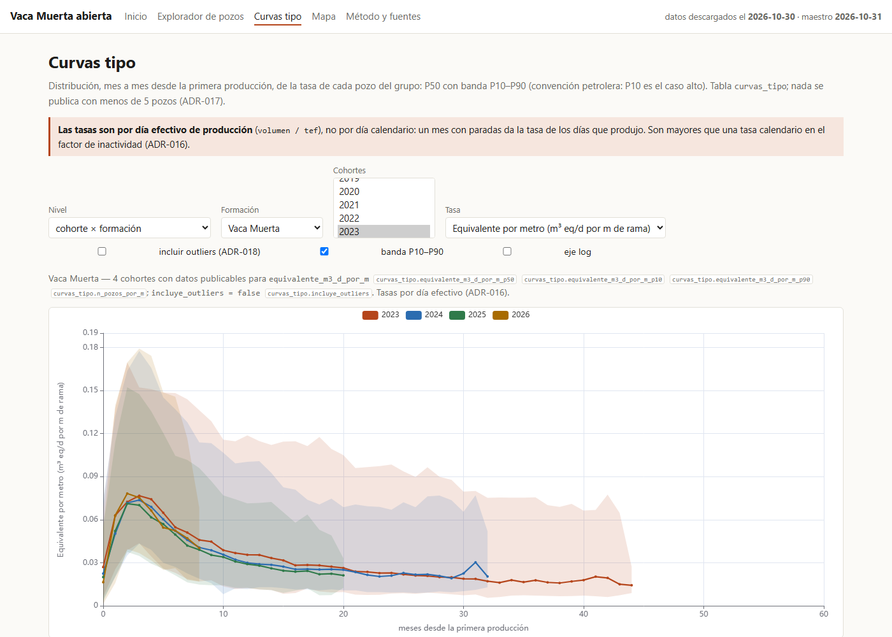
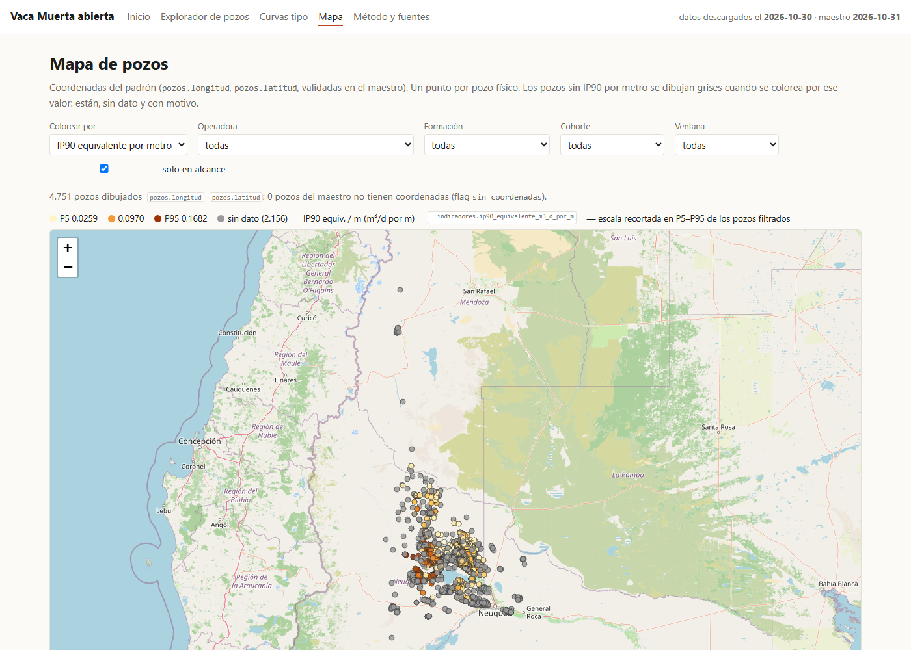
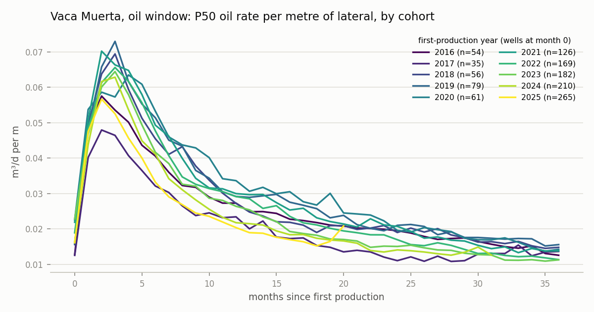
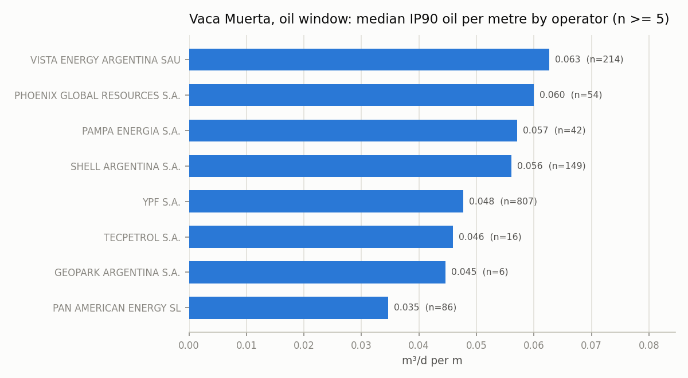
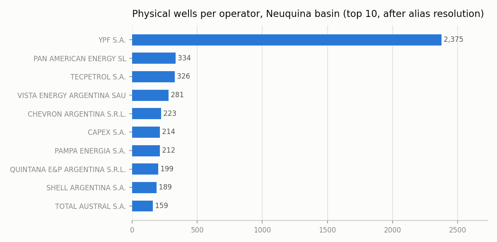
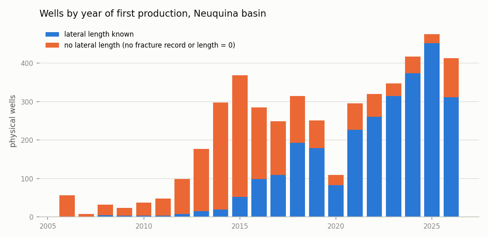
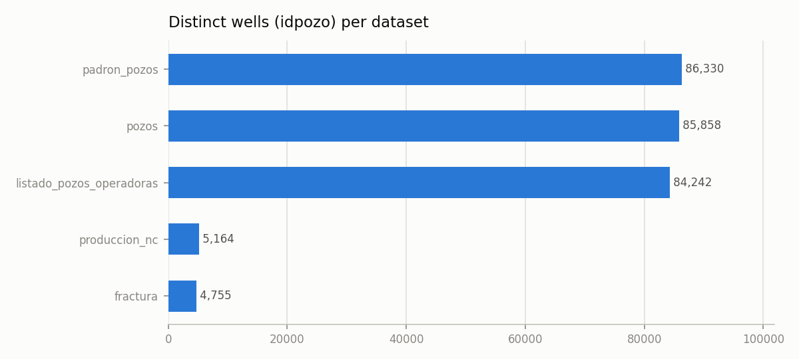
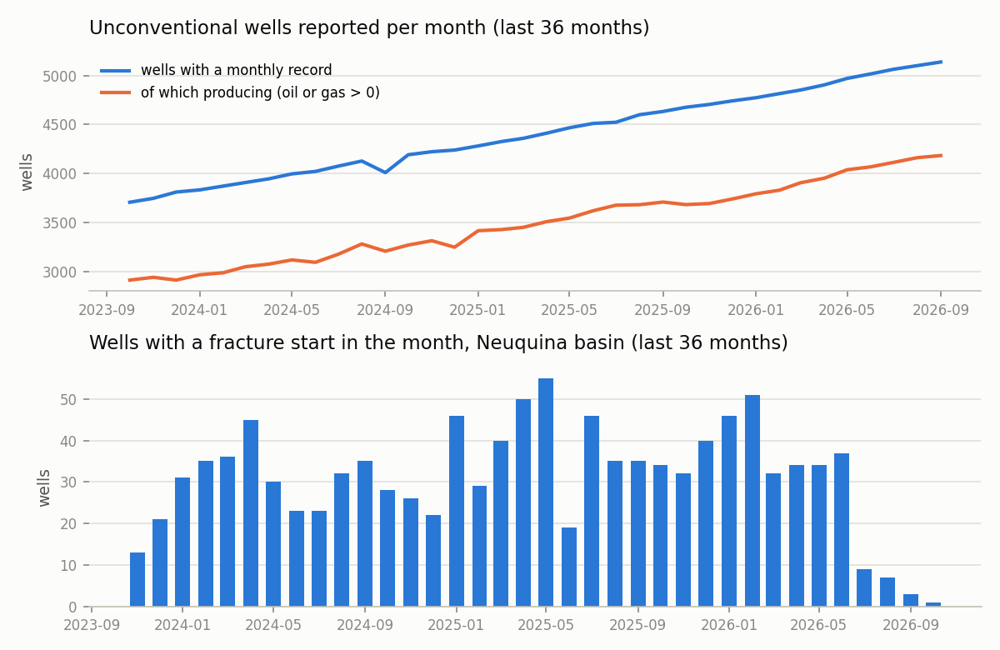

# vaca-muerta-abierta

**Argentina's public per-well oil & gas data (Capítulo IV), downloaded, measured, cleaned and cross-referenced.
Open code, open data, visible lineage.**

*Versión en español: [LEEME.md](LEEME.md).*

The Secretaría de Energía publishes, for every well in the country, monthly production, fracture jobs
(lateral length, stages, proppant, water), a well register with coordinates and drilling dates, and drilling
activity. It is the same data the paid aggregators resell, and it is dirty: three identities written in free
text, two different well keys, placeholder dates, zero-length laterals, a "daily" dataset that lags three months.

This repository builds an **open observatory** on top of it, in phases that each end with something published:

| phase | what | status |
|---|---|---|
| **F0 · Measure the dirt** | dated, hashed download of every dataset; real schema of each file; a data-quality report with numbers and charts; alias drafts; decisions | **done** → [`informes/calidad-2026-10-30.md`](informes/calidad-2026-10-30.md) |
| **F1 · Well master** | one row per physical well, every spelling of its sigla as alias, operator and formation normalised with versioned alias tables, coordinates validated, lateral length with explicit precedence, first production computed; published as CSV + Parquet with per-row lineage and flags | **done** → [`informes/maestro-2026-10-31.md`](informes/maestro-2026-10-31.md) |
| **F2 · Indicators** | one row per well: IP30/90/180 in producing days, cumulatives at 6/12/24 months, everything per metre of lateral, GOR, water cut, fluid window, flags and lineage; type curves P10/P50/P90 by cohort × formation (× window, × operator) with `n_pozos`, published with and without outliers | **done** → [`informes/indicadores-2026-10-31.md`](informes/indicadores-2026-10-31.md) |
| **F3 · Site** | static explorer: wells table with "no data because…" cells, type curves P10/P50/P90 with `n`, Leaflet map, method page; pre-aggregated JSON from the pipeline, rebuilt monthly by CI and deployed to GitHub Pages | **done** → [lucasburriel.github.io/vaca-muerta-abierta](https://lucasburriel.github.io/vaca-muerta-abierta/) |
| **F4 · Ask it questions** | a local agent (`agente.py`, CLI + chat) and an MCP server (`mcp_server.py`) over seven typed, read-only tools on the published tables; every result carries its citation (table, columns, filters, rule); a validator rejects any number the tools did not return; works on the committed JSON snapshot or on the Parquet tables | **done** → [`docs/agente.md`](docs/agente.md), [`docs/ejemplos-agente.md`](docs/ejemplos-agente.md) |
| **F5 · Compare your wells** | a "my data" module: load your own monthly production (CSV/Parquet) in the session, compare each well with the published type curve of its cohort × formation × window, each campaign with its public medians, gaps below P50, neighbours on a map; Arps/Duong decline fits with EUR and a bootstrap band, campaign Monte Carlo from the published curves; MCP Apps views in Claude Desktop with text fallback; `vma-mcp` installable with `uvx`; five more public datasets catalogued (reserves, prices, royalties, field production, concessions); a synthetic dataset for tests and demos. Your data never leaves your machine | **done** → [For operators](#for-operators-compare-your-wells-f5-2026-11-02), [`docs/mis-datos.md`](docs/mis-datos.md), [`docs/simulacion.md`](docs/simulacion.md), [`docs/mcp-apps.md`](docs/mcp-apps.md) |

## For operators: compare your wells (F5, 2026-11-02)

The same tools, now for people inside an operating company: point the agent at a CSV or Parquet with your own
monthly production per well and ask how each well, each pad or each campaign compares with the Capítulo IV.
**Your file never leaves your machine**: it is read into the in-memory database of the process you run, compared,
and gone when the process ends; nothing is written, cached or uploaded (ADR-030). Bring your own key, as in F4.

| tool | what it answers |
|---|---|
| `cargar_mis_pozos(ruta, mapeo?, ruta_pozos?)` | loads your file (schema and aliases in [docs/mis-datos.md](docs/mis-datos.md)), computes your indicators with the published rules |
| `comparar_mi_pozo(sigla)` | your well month by month against the P10/P50/P90 of its cohort × formation × window, with an estimated percentile; your IP90, IP90/m and 12-month cumulative against the public group |
| `comparar_mi_campania(filtros)` | each of your wells against the public median of its own group, and the campaign summary |
| `brechas(sigla | filtros)` | where and how much you are below P50, by month and cumulated, in rate and in volume |
| `vecinos_de_mis_pozos(radio_km)` | your wells among the public wells around them, with the metric on both sides |
| `pronosticar_pozo(sigla, mio?)` | Arps / Duong decline fit, EUR to 20-30 years with a bootstrap band ([docs/simulacion.md](docs/simulacion.md)) |
| `pronosticar_curva_tipo(nivel, claves)` | the same on a published type curve (works on a fresh clone) |
| `simular_campania(formacion, n_pozos, …)` | Monte Carlo of a campaign sampled from a published type curve: P10/P50/P90 of rate and cumulative per month |

In **Claude Desktop** (and other hosts that implement [MCP Apps](https://github.com/modelcontextprotocol/ext-apps))
four of them also open a view in the chat: the type curve with your well on top, the map of your wells among the
neighbours, the campaign ranking with your position, and a campaign simulator with controls
([docs/mcp-apps.md](docs/mcp-apps.md)). Everywhere else the tools answer the same cited JSON.



### Install

```bash
# from a clone (everything, including the pipeline)
pip install -e ".[dev,agente]"
# or as a package, no clone: the server downloads the public JSON snapshot once into ~/.vaca-muerta-abierta/
uvx --from "git+https://github.com/LucasBurriel/vaca-muerta-abierta" vma-mcp
pip install "vaca-muerta-abierta[mcp] @ git+https://github.com/LucasBurriel/vaca-muerta-abierta" && vma-mcp
```

`VMA_DATOS=/path/with/site/data` (or `--datos`) points the server at other data, for example the Parquet tables of
a release. The MCP server needs only `mcp`; the CLI agent with Claude needs `anthropic` and `ANTHROPIC_API_KEY`.

### Configure your client

Claude Desktop (`claude_desktop_config.json`), renders the views:

```json
{"mcpServers": {"vaca-muerta-abierta": {"command": "uvx",
  "args": ["--from", "git+https://github.com/LucasBurriel/vaca-muerta-abierta", "vma-mcp"]}}}
```

Claude Code (`.mcp.json` in your project, or `claude mcp add vaca-muerta-abierta -- uvx --from git+https://github.com/LucasBurriel/vaca-muerta-abierta vma-mcp`), text only:

```json
{"mcpServers": {"vaca-muerta-abierta": {"command": "uvx",
  "args": ["--from", "git+https://github.com/LucasBurriel/vaca-muerta-abierta", "vma-mcp"]}}}
```

Cursor (`.cursor/mcp.json`), text only:

```json
{"mcpServers": {"vaca-muerta-abierta": {"command": "uvx",
  "args": ["--from", "git+https://github.com/LucasBurriel/vaca-muerta-abierta", "vma-mcp"],
  "env": {"VMA_DATOS": "C:/path/to/vaca-muerta-abierta"}}}}
```

From a clone, replace `uvx …` by `python C:/path/to/vaca-muerta-abierta/mcp_server.py` (add `--sin-apps` to drop
the views, `--sql` for the opt-in SQL tool). Then, in the chat: *cargá mis pozos de C:/datos/mios.csv y compará mi
pozo X-12 con su curva tipo*.

### Try it without your data

`python pipeline.py sintetico` derives a synthetic "my wells" dataset from public wells with noise; a 30-well copy is
committed in `tests/fixtures/sintetico/` and used by the tests, by `python -m vma.apps.demo --servir` (a local host
that renders the four views) and by the transcripts in [docs/ejemplos-agente.md](docs/ejemplos-agente.md).

### Manual step for the owner: publish the tables as a release

The full Parquet tables (`data/publicado/<date>/pozos.parquet`, `indicadores.parquet`, `curvas_tipo.parquet`, about
20 MB) are not committed and the portal does not answer CI (ADR-024). To let users run the server on the full
tables without downloading 460 MB from the portal: build them locally, then
`gh release create datos-<date> data/publicado/<date>/*.parquet --title "Tablas publicadas <date>"` and document the
release tag here; users unzip into any folder with a `data/publicado/<date>/` layout and point `VMA_DATOS` at it.
Not done in F5 (ADR-033).

## Ask it questions (F4, 2026-11-01)

**Bring your own key.** The agent runs on your machine, against your own Anthropic account: clone the repo, set
`ANTHROPIC_API_KEY`, ask. Nothing is hosted and no key is shared; the site stays free because it is static, the
agent is yours to pay for. Without a key it falls back to a model-free mock, so tests and the demo run anyway.

```
$ python agente.py "¿Qué operadora tiene la mejor mediana de IP90 de petróleo por metro en Vaca Muerta, ventana de petróleo, cohorte 2024?"
  -> ranking({"filtros": {"formacion": "Vaca Muerta", "ventana": "petroleo", "cohorte": 2024}, "top": 5})

  · PHOENIX GLOBAL RESOURCES S.A.: mediana 0.06645, P25 0.0516, P75 0.08425, n = 10 de 10
  · VISTA ENERGY ARGENTINA SAU: mediana 0.06231, P25 0.0548, P75 0.07547, n = 48 de 50
  · SHELL ARGENTINA S.A.: mediana 0.04888, P25 0.03063, P75 0.06415, n = 22 de 22
    [indicadores.ip90_petroleo_m3_d_por_m; formacion = Vaca Muerta, ventana = petroleo, cohorte = 2024, en_alcance, n_min = 5]
  Sin dato porque: flags sin_rama_sin_fractura: 25; flags rama_corta: 1
  Exclusión: 3 grupo(s) con menos de 5 pozos con dato quedan fuera del ranking (ADR-017)
  Nota: las tasas son por día efectivo de producción (tef), no por día calendario (ADR-016)
Datos: descargados el 2026-10-30, maestro 2026-10-31, fuente parquet

[validador: ok: todos los números de la respuesta salen de una herramienta]
```

The model (`claude-opus-5-5` by default; `--proveedor mock` runs the same loop without a model) never writes SQL
against the data: it chooses among seven read-only tools, `metadatos` · `describir_tabla` · `buscar_pozo` ·
`ficha_pozo` · `comparar_grupo` · `ranking` · `curva_tipo`, each a tested function that builds its own query from
allowlists and returns `{datos, cita: {tabla, columnas, filtros, regla_doc}, exclusiones, notas, fecha_datos,
version_maestro, fuente}`. The system prompt asks for a citation after every number and a "sin dato porque…" for every
null; a **validator** then checks that every number in the answer exists in a tool result of that turn (with rounding)
and makes the model redo the answer once if not (ADR-027). `--sql` opts into `sql_solo_lectura` (SELECT only, three
tables, LIMIT and timeout forced, documented as a risk in ADR-025). The agent works on a fresh clone through the
committed `site/data/` snapshot and picks up the Parquet tables when they are built (ADR-026).

The same tools are an **MCP server** for Claude Desktop / Claude Code:

```json
{"mcpServers": {"vaca-muerta-abierta": {"command": "python", "args": ["/path/to/vaca-muerta-abierta/mcp_server.py"]}}}
```

Details, tool table and the transcripts of five questions: [`docs/agente.md`](docs/agente.md),
[`docs/ejemplos-agente.md`](docs/ejemplos-agente.md).

## The site (F3, 2026-10-31)

**[lucasburriel.github.io/vaca-muerta-abierta](https://lucasburriel.github.io/vaca-muerta-abierta/)** — static,
no build step, no backend: HTML + ES modules reading pre-aggregated JSON that `python pipeline.py site` writes from
the published tables (ADR-021, ADR-022). Every number on screen carries a `tabla.columna` chip; every empty cell
says why it is empty (the row's `flags`); every rate says it is per producing day. Rebuilt on the 5th of each month
by [`publish.yml`](.github/workflows/publish.yml) (ADR-024). Pages: home with the F0-F2 headlines, well explorer
(filters, sort, CSV download), type curves (level, formation, window/operator, cohorts, outlier toggle, log axis),
map (colour by IP90 per metre or by category, popup with the reason for each missing value), method and sources
(manifest hashes, tables, rules, licences).




## What F2 found (2026-10-31)

Full report: [`informes/indicadores-2026-10-31.md`](informes/indicadores-2026-10-31.md); formulas, units and rules:
[`docs/indicadores.md`](docs/indicadores.md). Headlines:

1. **Per-metre comparison covers 2,689 of 4,625 producing wells (58 %).** The rest have no lateral length in the
   public fracture file (1,001 no record, 856 length 0, 178 horizontal wells with length 0) or a lateral under
   500 m (27). Every one of them is in the table with the reason; none is a zero.
2. **IP is measured in producing days, not calendar days**: 46 % of the wells start in a partial month. IP30 /
   IP90 / IP180 are computable for 99 % / 96 % / 92 % of producing wells; 12-month cumulatives for 90 %.
3. **Vaca Muerta laterals doubled in a decade and productivity per metre did not fall.** Median lateral: 1,206 m
   for the 2015 cohort, 2,000 m in 2018, 3,042 m in 2025. In the oil window, median IP90 of oil per metre stays
   between 0.045 and 0.056 m³/d per m for every cohort from 2016 to 2025 while the median lateral went from
   1,409 m to 3,064 m; stages per 100 m went from 1.3 to 1.7.
4. **The fluid window matters more than the operator.** Oil-equivalent per metre ranked gas-window operators first
   until the window (derived from each well's own GOR, ADR-020) was separated: in the oil window the top medians
   are 0.063, 0.060 and 0.057 m³/d per m with n = 214, 54 and 42; the 2018 cohort "anomaly" is 54 % gas wells.
5. **17 outliers out of 2,592 screened, all low** — wells that produced under 20 m³/d of oil equivalent in their
   first 90 producing days over a 2,000 m lateral. Marked with the rule and the z-score, never deleted; the type
   curves are published with and without them (`incluye_outliers`).




## What F1 found (2026-10-31)

Full report: [`informes/maestro-2026-10-31.md`](informes/maestro-2026-10-31.md); columns and rules:
[`docs/maestro.md`](docs/maestro.md). Headlines:

1. **5,960 `idpozo` are 5,750 physical wells.** 189 wells carry two or more `idpozo` (188 because they are
   reported on two formations); only **one** sigla in the whole universe has two raw spellings
   (`APA.NQ.Gu-1160` / `APA.Nq.Gu-1160`). Identity in this data is about grain and about *names of companies*,
   not about well codes.
2. **The padrón's "first production month" is a year.** 99.4 % of its rows say January; computed from the
   production file (first month with oil or gas > 0), the month differs for 74 % of wells. The master publishes
   both and flags the difference.
3. **Operator history matters more than operator spelling.** Six names merge into others (renames evidenced by
   the same wells changing name in one month: Vista Oil & Gas → Vista Energy, PAE LLC → SL, GeoPark Ltd. → S.A.,
   two pure spellings); 714 wells (12 %) changed hands in the production history — asset sales that are kept as
   `operadoras_historicas`, never merged.
4. **Lateral length is known for 2,735 of 5,050 Neuquina wells.** 1,001 have no fracture record; 1,314 have
   records whose length is 0, 181 of them with ≥ 10 stages (horizontal wells, length missing → null, never 0).
   Median lateral where known: 2,550 m, 41 stages. Coverage by year is in the chart below: before 2015 almost
   nothing, since 2021 above 75 %.
5. **The rest is small and corrected, not deleted**: 1 well with longitude/latitude swapped (the 70 rows of F0
   were one well × 70 months), 65 wells with placeholder drilling dates (1902/1910) nulled, 175 with depth 0,
   4 with depth above 8,000 m kept and flagged, 0 wells outside their basin's bounding box.




## What F0 found (2026-10-30)

Full report: [`informes/calidad-2026-10-30.md`](informes/calidad-2026-10-30.md). Headlines:

1. **`idpozo` is not a well.** It is a *well × productive formation*: 6,167 siglas in the register have more than
   one `idpozo`, 6,019 of them because the formation differs. Every cross-dataset join on `idpozo` is clean
   (0 sigla disagreements across 5,164 production wells); the entity-resolution problem is grain, not spelling.
   Sigla normalisation (trim / upper / drop `(h)` / alphanumerics) moves cross-matches by < 0.3 %.
2. **The drilling datasets are aggregates**, not per-well: monthly counts by company × area × concept. Per-well
   drilling/completion dates live only in the register, 40 % empty, with `1900-01-01` placeholders (3,922 rows).
3. **Fracture data: 41 % of records have lateral length = 0** (1,071 of 3,821 unconventional Neuquina records),
   177 of them with ≥ 10 stages, i.e. horizontal wells with the length missing. 1,169 Neuquina production wells
   have no fracture record at all. The "daily update" file is visibly incomplete for its last 3-4 months.
4. **Operators are nearly clean, formations are already clean.** 123 operator keys, 5 with two spellings
   (`VISTA OIL & GAS ARGENTINA SAU` / `Vista Oil & Gas Argentina SA`, `PAN AMERICAN ENERGY (SUCURSAL ARGENTINA)
   LLC` / `PAN AMERICAN ENERGY SL`, …); inside the production file `idempresa → empresa` is one-to-one.
   78 formation names, zero spelling variants; the real gap is that `vaca muerta` carries no landing level.
5. **Production is published complete and revised backwards**: the number of wells with a record grows every
   month to the last one (2026-09, one month lag), no trailing partial month, `rectificado` flags revisions.
   Suspicious values are rare but present: 70 rows with longitude/latitude swapped, 384 well-months with
   production and zero producing days, 15 with more than 31 producing days, 160 with depth > 8,000 m.




## Run it

```bash
git clone https://github.com/LucasBurriel/vaca-muerta-abierta && cd vaca-muerta-abierta
pip install -e ".[dev]"
python -m pytest -q            # 178 tests, no network, no data, no model needed

python pipeline.py sources     # the catalogue (vma/sources.py)
python pipeline.py download    # ~460 MB -> data/raw/<today>/ + manifest.json (URL, bytes, sha256, CKAN last_modified)
python pipeline.py schema      # real schema of every file -> docs/esquemas/*.md
python pipeline.py quality     # informes/calidad-<today>.md + docs/calidad-*.png + alias/borradores/  (~2 min)
python pipeline.py master      # data/publicado/<today>/pozos.{csv,parquet} + informes/maestro-<today>.md  (~1 min)
python pipeline.py diff        # informes/diff-<a>-<b>.md between the last two downloads (or --a/--b)
python pipeline.py indicadores # data/publicado/<today>/indicadores.{csv,parquet}  (~10 s)
python pipeline.py curvas      # data/publicado/<today>/curvas_tipo.{csv,parquet} + informes/indicadores-<today>.md + docs/indicadores-*.png
python pipeline.py site        # site/data/*.json (+ meta.json) for the static site, from the latest published tables
cd site && python -m http.server 8000   # open http://localhost:8000

pip install -e ".[dev,agente]"  # F4: anthropic + mcp
export ANTHROPIC_API_KEY=...    # without it the agent runs the model-free mock and says so
python agente.py "¿Cómo es la curva tipo de Vaca Muerta 2022 en la ventana de petróleo?"
python agente.py --chat        # multi-turn; --proveedor mock, --fuente json, --sql, --json
python mcp_server.py           # MCP over stdio for Claude Desktop / Claude Code (MCP Apps views; --sin-apps, --sql)

python pipeline.py sintetico   # F5: a synthetic "my wells" dataset from public wells + noise -> data/sintetico/<today>/
python -m vma.apps.demo --servir   # F5: a local host that renders the four MCP Apps views on the synthetic data
vma-mcp                        # the server as an entry point (pip install -e . or uvx); data from the clone, VMA_DATOS or the cached snapshot
```

Python 3.11+. Dependencies: `duckdb`, `pandas`, `matplotlib` (+ `anthropic`, `mcp` for the agent). Raw data is never committed; the manifest is what
makes two downloads comparable. The site needs no Node and no server beyond a static file server.

GitHub Pages for a fork: enable it once with build type *GitHub Actions* (Settings → Pages, or
`gh api -X POST repos/<owner>/<repo>/pages -f build_type=workflow`), then run the `publish` workflow. Note: on 2026-11-01 the portal did not answer GitHub-hosted runners at all; the
workflow then deploys the committed `site/data/` snapshot and flags it in the run summary (ADR-024). To refresh the data,
run the pipeline where the portal is reachable and commit `site/data/`.

## Layout

```
pipeline.py           sources | download | schema | quality | master | diff | indicadores | curvas | site | sintetico
vma/
  sources.py          catalogue of CKAN datasets/resources (ids, URLs, sizes, default vs opt-in)
  download.py         dated download with manifest; network isolated behind an injectable opener
  schema.py           real schema dump: types, null %, cardinality, min/max, top values
  normalize.py        sigla levels L0-L4, operator and formation blocking keys
  units.py            the only place that converts units (bbl, Mcf, ft, lb/ft, oil equivalent)
  quality.py          the F0 report: cross-matching, variants, nulls, duplicates, ranges, lag, charts
  alias.py            the three versioned alias tables (variante, canonico, fuente, desde, nota)
  master.py           the F1 well master: one row per physical well, rules, flags, lineage, CSV + Parquet, report
  diff.py             differences between two dated downloads (new wells, rectified months, operator changes)
  indicadores.py      F2: monthly production per well, IP in producing days, cumulatives, per metre, GOR, window, outliers
  curvas.py           F2: type curves P10/P50/P90/mean by cohort × formation (× window, × operator), min 5 wells
  informe_indicadores.py  the F2 report and its four charts
  site.py             F3: pre-aggregated JSON for the site (pozos, curvas per level, resumen, meta with manifest hashes)
  consulta/           F4: datos.py (DuckDB views over Parquet or site JSON) · herramientas.py (the seven tools + opt-in SQL,
                      every result with its citation) · validador.py (no number without a tool result) · agente.py (loop, providers)
  propios/            F5: the user's own wells: esquema.py (schema, aliases, validation) · cargar.py (indicators with the published rules,
                      in-memory views) · comparar.py (well vs curve, campaign vs medians, gaps) · sintetico.py (public wells + noise)
  simulacion/         F5: declinacion.py (Arps, Duong, EUR, bootstrap) · campania.py (Monte Carlo from a type curve) · series.py
  apps/               F5: MCP Apps: four ui:// views (ui/*.html + puente.js + base.css), tool meta, resource CSP; demo.py (local test host)
  consulta/ubicacion.py  F5: where the data is when installed as a package (clone, VMA_DATOS, cached public snapshot)
agente.py             ask a question or chat; mcp_server.py  the same tools as an MCP server (stdio); entry points vma-agente, vma-mcp
site/                 the static site: index · explorador · curvas · mapa · metodo (.html), js/, css/, data/ (generated, committed)
.github/workflows/    tests.yml (every push, no data; runs the mock agent) · publish.yml (monthly + manual: download → tables → site → GitHub Pages)
docs/
  fuentes.md          every dataset: URL, licence, grain, size, last data, units as published; the extended catalogue (F5)
  decisiones.md       ADRs 001-033: name, scope, well key, units, raw-data policy, stack, capiv, lateral
                      precedence, master universe, alias policy, placeholder dates, publication format,
                      indicator grain, producing-day rates, minimum wells, outlier rule, lateral threshold, fluid window,
                      site stack, site data (JSON vs Parquet in the browser), what the site cuts, publish cadence,
                      F4 local agent + MCP without free SQL, Parquet/JSON double source, citation validator, model + mock,
                      F5 extended catalogue, own data never persisted + synthetic, simulation declared as DCA, MCP Apps, packaging
  maestro.md          every column of the master with its rule, and every flag
  indicadores.md      every column of indicadores and curvas_tipo: formula, units, rule, flags
  agente.md           F4: the tools, the envelope, the validator, providers, MCP config · ejemplos-agente.md  transcripts (F4 and F5)
  mis-datos.md        F5: your file's schema, mapping, validation, what is computed, the comparison tools, the synthetic dataset
  simulacion.md       F5: decline models, fitting, EUR, bootstrap band, campaign Monte Carlo, assumptions and limits
  mcp-apps.md         F5: the four views, how the extension is served from Python, configuration, how it was tested
  esquemas/           one markdown per dataset with its real columns
  calidad-*.png       charts of the quality report · maestro-*.png  charts of the master report · sitio-*.png  screenshots of the site
informes/             dated reports: calidad-<date>.md (F0), maestro-<date>.md (F1), indicadores-<date>.md (F2), diff-<a>-<b>.md
alias/                operadoras.csv, formaciones.csv (curated), siglas.csv (appended by the build); borradores/
data/publicado/       <date>/pozos.* (master), indicadores.* (one row per well), curvas_tipo.* (git-ignored, rebuild or take the release)
tests/                pytest, tiny CSV fixtures (master, diff), fake network, site JSON + JS/table column contract, F4 tools on Parquet and JSON + validator + mock agent,
                      F5 own data + synthetic fixture, decline fits and Monte Carlo, MCP Apps protocol on an in-memory client, packaging
```

## Rules this repository follows

- **Only public data**, cited with URL, licence and download date ([docs/fuentes.md](docs/fuentes.md)).
- **Code written from scratch**; no employer, client or colleague is named or used. Every operator in the
  basin is a row of a public dataset and is treated the same.
- **Reproducible**: one command per stage, same result on any laptop, CI runs the tests on every push.
- **Lineage is part of the data**: every quality rule is a SQL predicate printed in the report; every future
  indicator will carry the columns and rule it came from.
- **Outliers are flagged, never deleted. Missing data is "no data, because…", never zero.**
- **No number without a citation**: the site prints `tabla.columna` next to every value; the agent cites the tool, table, columns and filters behind every number, and a validator checks it.

## Related

[`capiv`](https://github.com/LucasBurriel/capiv) (same author) benchmarks a company's own wells against the
public production file with a Claude agent choosing among fixed comparisons. The two projects share a data
source and nothing else; see [ADR-007](docs/decisiones.md#adr-007--relationship-with-capiv-2026-10-30).

## Licence

Code: MIT. Data: CC-BY 4.0, Secretaría de Energía de la Nación Argentina.
