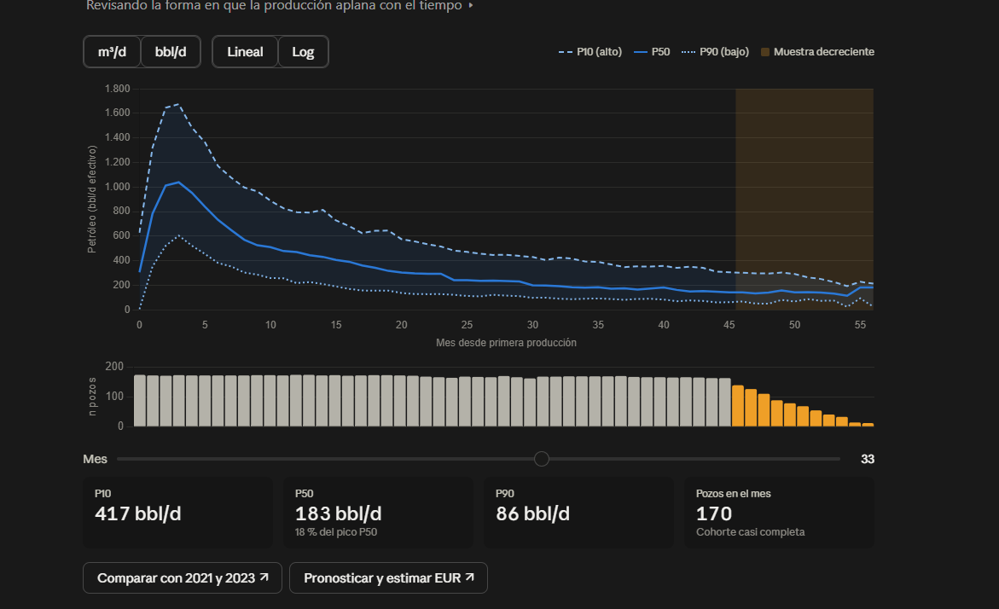
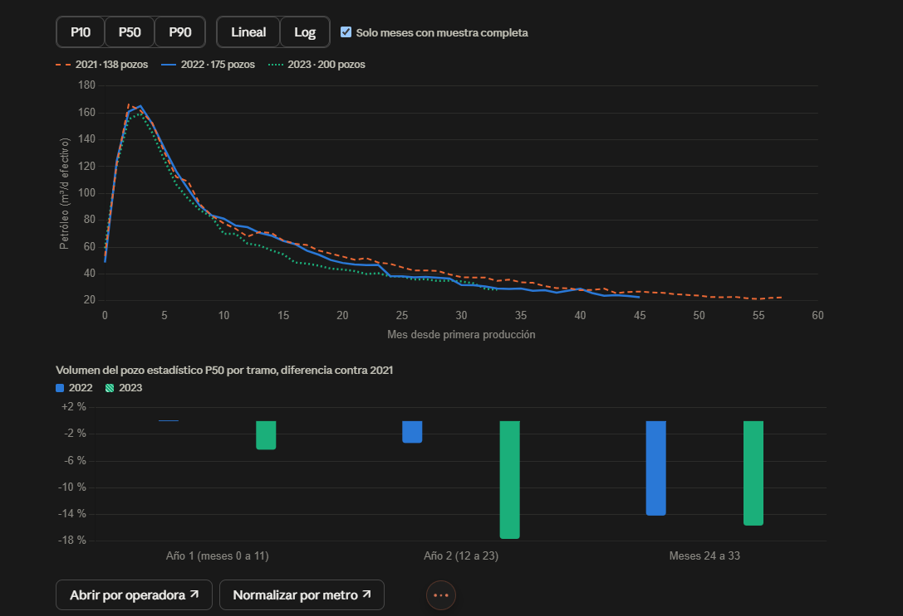
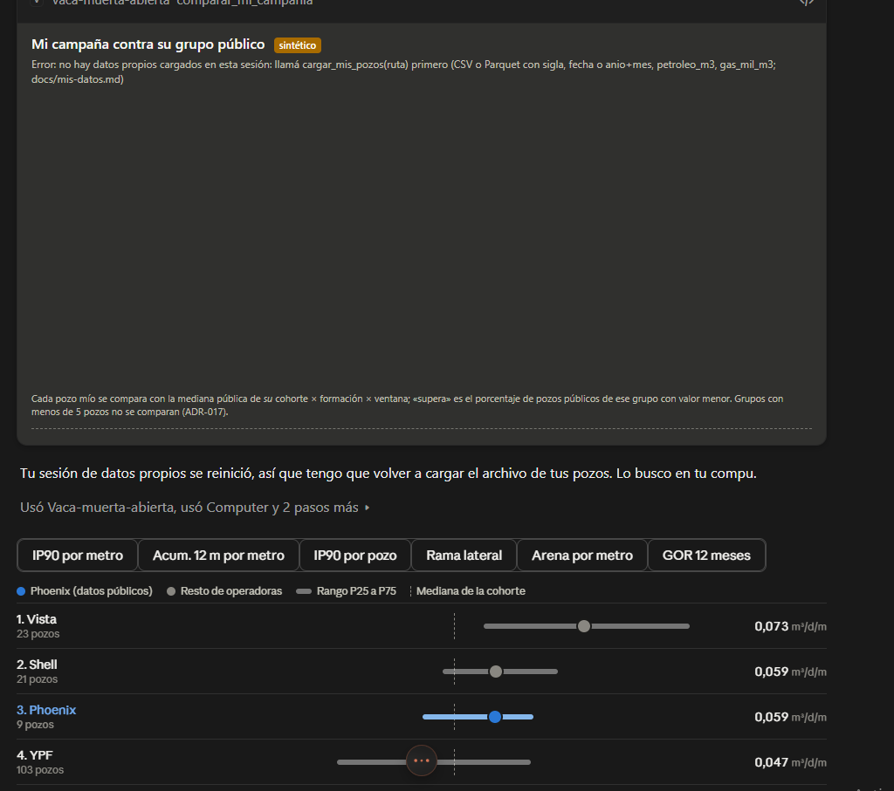
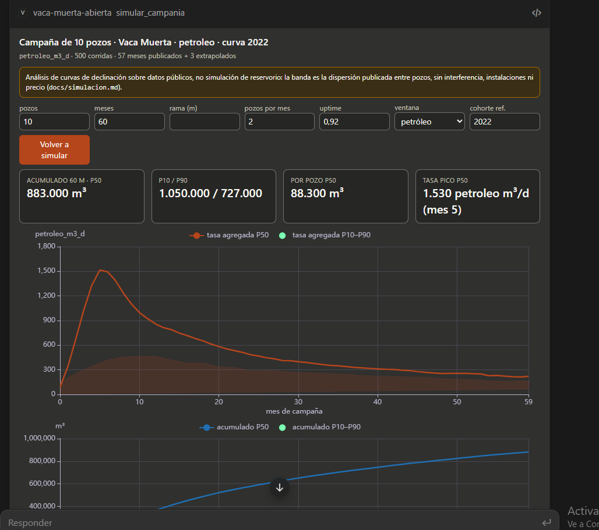

# MCP Apps: las vistas del observatorio dentro del chat (F5, `vma/apps/`)

[MCP Apps](https://github.com/modelcontextprotocol/ext-apps) es la extensión oficial `io.modelcontextprotocol/ui`
del Model Context Protocol (spec estable **2026-01-26**): un servidor MCP puede asociar a una herramienta un
recurso `ui://` con HTML, y el host (Claude Desktop, ChatGPT, VS Code, Goose, Postman y otros listados en el README
de la extensión) lo dibuja en un iframe al lado de la respuesta del modelo. Un host que no implementa la extensión
ignora la metadata y muestra el texto de la herramienta: el **fallback** es el resultado JSON con su cita, el mismo
que ven el agente CLI y Claude Code, que hoy no renderiza Apps. ADR-032.

## Qué hay

| recurso | herramienta | qué dibuja |
|---|---|---|
| `ui://vaca-muerta/curva_mia.html` | `comparar_mi_pozo` | P10/P50/P90 publicados del grupo con la historia del pozo propio superpuesta (eje log), percentil por mes, IP90 e IP90/m contra el grupo, tabla mensual |
| `ui://vaca-muerta/mapa_vecinos.html` | `vecinos_de_mis_pozos` | mapa Leaflet con mis pozos y los pozos públicos vecinos (tamaño ∝ métrica), popup con operadora, cohorte, ventana, rama y distancia; tabla mío vs mediana de vecinos |
| `ui://vaca-muerta/ranking_posicion.html` | `comparar_mi_campania` | barras del cociente mío / mediana pública por pozo, con el porcentaje de pozos públicos que supera; tarjetas del resumen |
| `ui://vaca-muerta/simulador_campania.html` | `simular_campania` | bandas P10/P50/P90 de tasa agregada y acumulado, tarjetas del final y **controles** (pozos, meses, rama, ritmo, uptime, ventana, cohorte) que vuelven a llamar a la herramienta desde el iframe |

Todo lo que se dibuja sale del mismo envelope que el modelo recibe como texto, cita incluida (se muestra al pie de
cada vista). Los datos de ejemplo de la documentación y del host de prueba son el sintético de
`tests/fixtures/sintetico/` y las vistas lo marcan con una etiqueta «sintético» leída de las `notas`.

## Cómo está hecho (sin SDK de TypeScript)

- **Herramienta → vista**: `_meta.ui.resourceUri` (y `visibility: ["model", "app"]`, para que el iframe pueda
  llamar a la herramienta) en la definición de la tool; FastMCP lo acepta con `@mcp.tool(meta=...)`.
- **Recurso**: `@mcp.resource("ui://vaca-muerta/<vista>.html", mime_type="text/html;profile=mcp-app")`. El
  `resources/read` de FastMCP no tiene dónde poner `_meta`, así que `vma/apps/__init__.py:instalar` envuelve el
  handler de bajo nivel de `ReadResourceRequest` y agrega a los contenidos `ui://` su `_meta.ui`:
  `csp.resourceDomains` con los únicos orígenes externos que la vista carga (`https://cdnjs.cloudflare.com`; el
  mapa suma `tile.openstreetmap.org`), `connectDomains` vacío (las vistas no hacen `fetch`), `prefersBorder`.
- **El puente** (`vma/apps/ui/puente.js`, inyectado en cada HTML): JSON-RPC 2.0 por `postMessage`.
  `ui/initialize` → `hostContext` (tema, variables CSS) → `ui/notifications/initialized` → el host manda
  `ui/notifications/tool-input` y `ui/notifications/tool-result`; la vista informa `ui/notifications/size-changed`
  con un `ResizeObserver`, contesta `ui/resource-teardown` y `ping`, y aplica `host-context-changed` (tema). El
  simulador usa `tools/call` para re-simular. Si la página se abre sola (sin host) lo dice y no hace nada.
- **Autocontenido**: cada recurso es un documento HTML5 con el CSS y el puente inline y ECharts 5.5.0 / Leaflet
  1.9.4 desde cdnjs con versión fija e `integrity`, exactamente como el sitio estático (ADR-021). Las variables de
  estilo del host (`--color-background-primary`, `--font-sans`, …) ganan sobre los valores por defecto, con
  `light-dark()` para el tema.
- **Fallback**: todas las herramientas siguen devolviendo `content` de texto (la spec lo exige y ADR-025 ya lo
  hacía). `python mcp_server.py --sin-apps` quita `_meta.ui` y los recursos, para hosts que se confundan.

## Configuración

Claude Desktop (`claude_desktop_config.json`), Claude Code (`.mcp.json`) y Cursor usan el mismo bloque; sólo
Claude Desktop (y los otros hosts del README) dibuja las vistas, los demás muestran el texto:

```json
{"mcpServers": {"vaca-muerta-abierta": {"command": "python", "args": ["C:/ruta/al/repo/mcp_server.py"]}}}
```

Con el paquete instalado (`pip install -e ".[agente]"` o `uvx`), `vma-mcp` reemplaza a `python mcp_server.py`
(ver README, *For operators*).

## Cómo se probó

1. **Protocolo, en tests** (`tests/test_apps.py`): una sesión cliente en memoria contra el servidor real
   (`mcp.shared.memory`) comprueba que `tools/list` trae `_meta.ui.resourceUri` sólo en las cuatro herramientas,
   que `resources/list` y `resources/read` devuelven los `ui://` con MIME `text/html;profile=mcp-app` y
   `_meta.ui.csp.resourceDomains` exacto, que los documentos son HTML5 con los métodos `ui/*` y CDN fijados con
   `integrity`, que las herramientas siguen contestando texto, y que `--sin-apps` no anuncia nada.
2. **Host de prueba local** (`python -m vma.apps.demo [--servir]`): genera `data/apps-demo/host.html`, que carga
   las cuatro vistas en iframes y juega el lado host del protocolo con resultados reales de las herramientas sobre
   el sintético (con `--servir` atiende `tools/call` del simulador en `127.0.0.1:8765`). Sirve para mirar las
   vistas y el log de mensajes en cualquier navegador; no reemplaza a un host real.
3. **MCP Inspector**: no se corrió en esta sesión (requiere ejecutar un paquete npm externo, que el entorno de
   trabajo no permitió). Para probarlo: `npx @modelcontextprotocol/inspector python mcp_server.py` y mirar
   `tools/list` (`_meta`), `resources/read` (`_meta.ui.csp`).
4. **Claude Desktop** (2026-11-02, app de escritorio en Windows, servidor local por `vma-mcp --fuente json`):
   al pedir la curva tipo de Vaca Muerta 2022 en petróleo «con la vista interactiva», el host dibujó la vista
   dentro del chat: bandas P10/P50/P90, conmutadores m³/d–bbl/d y lineal–log, pozos por mes con la cola
   decreciente marcada, slider de mes con los cuatro indicadores y los botones de acción.

   

   En la misma sesión también dibujó la comparación de cohortes (botón «Comparar con 2021 y 2023»), el ranking
   de campañas y el simulador con sus controles:

   
   
   

   Lo que falló: el modelo no supo cargar el sintético porque pidió una carpeta y la herramienta exigía el
   archivo (y el host no deja listar el repo). Desde entonces `cargar_mis_pozos` acepta carpeta y el alias
   `sintetico` (`docs/mis-datos.md`). El mapa de vecinos sigue sin probarse en un host real.

## Límites

- Las vistas leen el resultado del texto JSON (`content[0].text`); si un host recorta el contenido largo, la vista
  dirá «sin datos». `simular_campania` ya acota el envelope (bandas por mes a 4 cifras).
- Sin `fetch` desde el iframe: todo pasa por el host (`tools/call`), que puede pedir confirmación al usuario.
- Los tiles de OpenStreetMap son un origen externo más: si el host no lo permite en su CSP, el mapa queda sin fondo
  pero los puntos y la tabla siguen.
- No hay negociación de capacidades por cliente: la metadata se anuncia siempre (la spec dice que los hosts sin la
  extensión la ignoran); `--sin-apps` es la salida manual.
