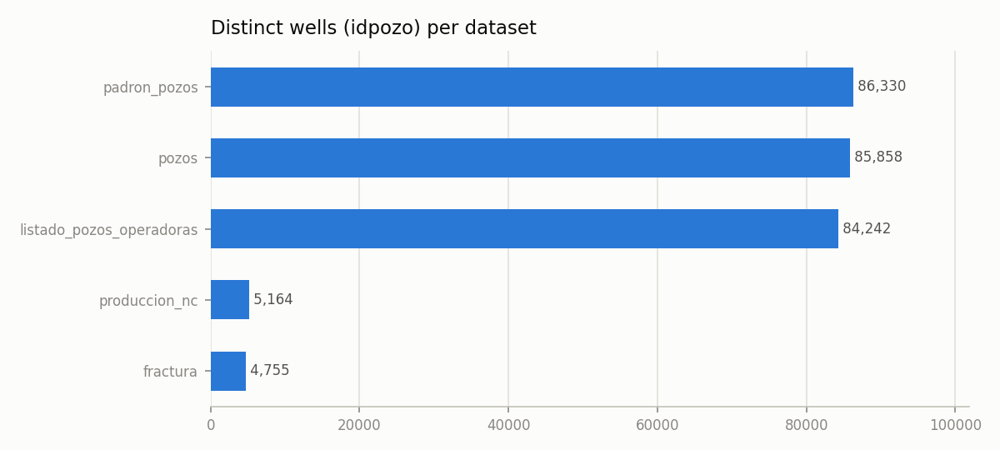
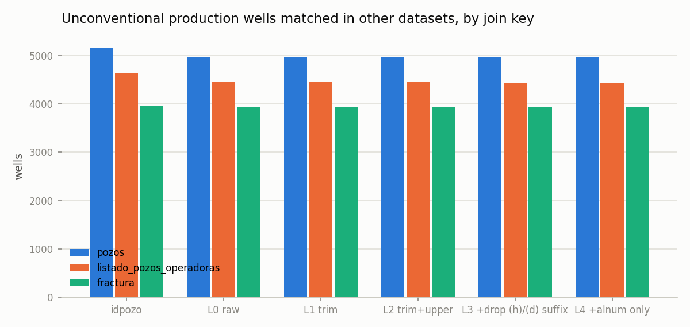
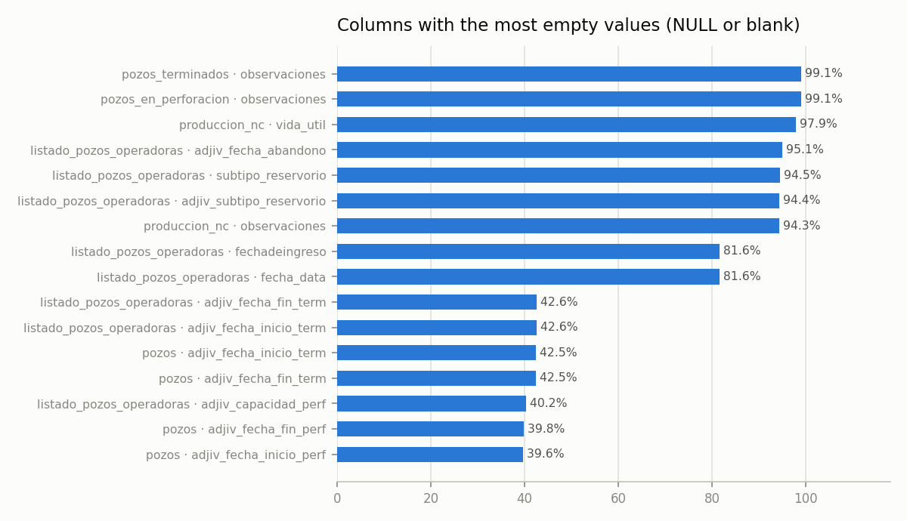
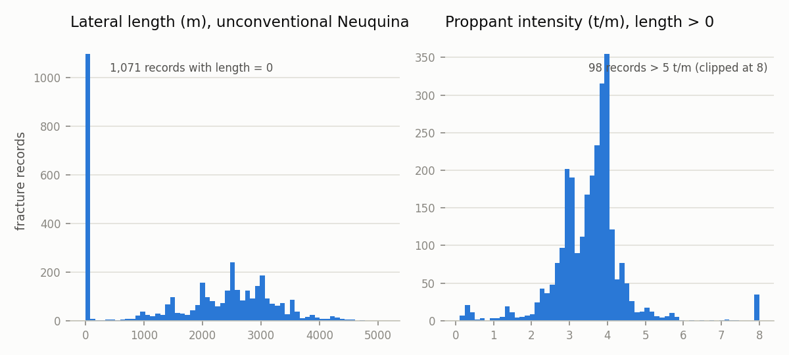
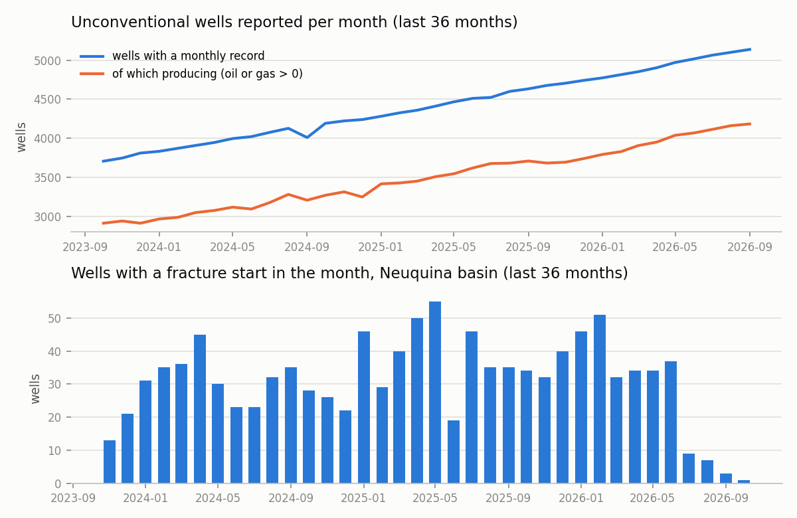

# Data quality report — 2026-10-30

Phase 0 of the observatory: *measure the dirt before building on it*. Every number below is
computed by `vma/quality.py` over the raw files in `data/raw/2026-10-30/` (never modified).
Scope of this first pass: the Neuquina basin, unconventional wells; conventional yearly files were not downloaded.

## 0. What was downloaded

| key | bytes | sha256 | CKAN last_modified |
|---|---|---|---|
| fractura | 1,254,362 | af87ed4dfe35… | 2026-10-30 |
| listado_pozos_operadoras | 27,071,868 | 7ef1c43bf490… | 2025-10-20 |
| padron_pozos | 1,171,351 | fc99e349313b… | 2026-10-10 |
| pozos | 34,216,363 | a8a7c757a616… | 2026-10-21 |
| pozos_en_perforacion | 68,256,503 | 2a60a9044b52… | 2026-10-20 |
| pozos_terminados | 191,872,641 | 8eb684fa9253… | 2026-10-24 |
| produccion_nc | 148,923,474 | 61cecc31c8dd… | 2026-10-22 |

## 1. Wells per dataset

| dataset | rows | distinct idpozo | distinct sigla (raw) |
|---|---|---|---|
| produccion_nc | 431,322 | 5,164 | 4,979 |
| pozos | 85,858 | 85,858 | 78,592 |
| padron_pozos | 86,330 | 86,330 |  |
| listado_pozos_operadoras | 84,242 | 84,242 | 77,061 |
| fractura | 4,999 | 4,755 | 4,713 |

Unconventional production by basin and resource sub-type:

| cuenca | sub_tipo_recurso | wells | well-months |
|---|---|---|---|
| NEUQUINA | SHALE | 3,524 | 230,735 |
| NEUQUINA | TIGHT | 1,411 | 183,014 |
| AUSTRAL | TIGHT | 206 | 16,244 |
| GOLFO SAN JORGE | TIGHT | 8 | 263 |
| GOLFO SAN JORGE | SHALE | 7 | 394 |
| NOROESTE | TIGHT | 3 | 185 |
| AUSTRAL |  | 2 | 344 |
| NEUQUINA |  | 2 | 116 |
| AUSTRAL | SHALE | 1 | 27 |

Fracture records (Adjunto IV) by basin and reservoir type:

| cuenca | tipo_reservorio | subtipo_reservorio | records | wells |
|---|---|---|---|---|
| NEUQUINA | NO CONVENCIONAL | SHALE | 3,118 | 3,100 |
| NEUQUINA | NO CONVENCIONAL | TIGHT | 701 | 666 |
| GOLFO SAN JORGE | CONVENCIONAL |  | 564 | 447 |
| NEUQUINA | CONVENCIONAL |  | 361 | 312 |
| AUSTRAL | NO CONVENCIONAL | TIGHT | 199 | 184 |
| GOLFO SAN JORGE |  |  | 18 | 15 |
| NEUQUINA |  |  | 13 | 10 |
| AUSTRAL | CONVENCIONAL |  | 7 | 7 |
| GOLFO SAN JORGE | NO CONVENCIONAL | SHALE | 4 | 1 |
| AUSTRAL |  |  | 4 | 4 |
| GOLFO SAN JORGE | NO CONVENCIONAL | TIGHT | 3 | 3 |
| AUSTRAL | NO CONVENCIONAL |  | 3 | 2 |
| NEUQUINA | NO CONVENCIONAL |  | 2 | 2 |
| NEUQUINA | NO DISCRIMINADO |  | 1 | 1 |
| AUSTRAL | NO CONVENCIONAL | SHALE | 1 | 1 |

**The drilling datasets are not per well.** `pozos_terminados` and `pozos_en_perforacion` are monthly
counts (`cantidad`) by company × area × concept, with no `idpozo` or `sigla`:

| concepto | rows |
|---|---|
| Productivos de Petróleo | 351,812 |
| Improductivos | 351,769 |
| Productivos de Gas | 351,768 |
| Servicio | 134,251 |

Per-well drilling and completion dates exist only in `pozos` (`adjiv_fecha_inicio_perf`, `adjiv_fecha_fin_perf`,
`adjiv_fecha_inicio_term`, `adjiv_fecha_fin_term`), 40 % empty. Cycle-time indicators will depend on that table.

## 2. Cross-matching between datasets

Wells of `produccion_nc` found in each other dataset. `by idpozo` joins on the numeric id; the `by sigla` columns
join on the well code after each normalisation level of `vma/normalize.py` (L0 raw → L4 letters and digits only).

| dataset | wells in produccion_nc | by idpozo | by sigla L0 raw | by sigla L1 trim | by sigla L2 trim+upper | by sigla L3 +drop (h)/(d) suffix | by sigla L4 +alnum only |
|---|---|---|---|---|---|---|---|
| pozos | 5,164 | 5,164 | 4,979 | 4,979 | 4,978 | 4,968 | 4,968 |
| padron_pozos | 5,164 | 5,127 |  |  |  |  |  |
| listado_pozos_operadoras | 5,164 | 4,634 | 4,448 | 4,448 | 4,447 | 4,438 | 4,438 |
| fractura | 5,164 | 3,959 | 3,941 | 3,941 | 3,941 | 3,941 | 3,941 |

Same thing from the fracture dataset's point of view:

| dataset | wells in fractura | by idpozo | by sigla L0 raw | by sigla L1 trim | by sigla L2 trim+upper | by sigla L3 +drop (h)/(d) suffix | by sigla L4 +alnum only |
|---|---|---|---|---|---|---|---|
| produccion_nc | 4,755 | 3,959 | 3,941 | 3,941 | 3,941 | 3,941 | 3,941 |
| pozos | 4,755 | 4,755 | 4,713 | 4,713 | 4,713 | 4,713 | 4,713 |

Consistency of the two keys: for the 5,164 wells shared by `produccion_nc` and `pozos`,
0 have a different raw sigla (0 after trim+upper);
for the 4,755 shared by `fractura` and `pozos`, 0 differ raw
(0 after trim+upper).

Siglas are *not* unique per well. In `pozos`, at each normalisation level:

| level | distinct siglas | siglas with >1 idpozo |
|---|---|---|
| L0 raw | 78,592 | 6,167 |
| L1 trim | 78,577 | 6,179 |
| L2 trim+upper | 78,539 | 6,207 |
| L3 +drop (h)/(d) suffix | 78,174 | 6,490 |
| L4 +alnum only | 77,977 | 6,665 |

Why: `idpozo` identifies a **well x productive formation**, not a physical well. The same sigla gets a new
`idpozo` for each formation it is reported on (the operator register even has a `unique_sigla_formprod` flag):

| siglas with >1 idpozo | idpozo involved | differ in formacion | differ in empresa | differ in yacimiento |
|---|---|---|---|---|
| 6,167 | 13,433 | 6,019 | 134 | 128 |

## 3. Spelling variants

### Operators — 123 distinct blocking keys, 5 with more than one spelling

Blocking key: accents removed, upper-case, legal forms (S.A., S.R.L., SAU, LLC, Sucursal Argentina…) and
punctuation stripped. Inside `produccion_nc` the pair `idempresa → empresa` is one-to-one; variants appear
*between* datasets. Full draft in `alias/operadoras.csv`.

| key | variants | datasets |
|---|---|---|
| CAPETROL | CAPETROL ARGENTINA S.A. · CAPETROL S.A. | pozos, pozos_terminados, produccion_nc |
| GEOPARK | GEOPARK ARGENTINA LTD. (SUCURSAL ARGENTINA) · GEOPARK ARGENTINA S.A. | fractura, pozos, pozos_terminados, produccion_nc |
| PAN AMERICAN ENERGY | PAN AMERICAN ENERGY (SUCURSAL ARGENTINA) LLC · PAN AMERICAN ENERGY SL | fractura, pozos, pozos_terminados, produccion_nc |
| VACA MUERTA INVERSIONES | VACA MUERTA INVERSIONES S.A. · VACA MUERTA INVERSIONES SAU | pozos, pozos_terminados, produccion_nc |
| VISTA OIL Y GAS | VISTA OIL & GAS ARGENTINA SAU · Vista Oil & Gas Argentina SA | fractura, pozos_terminados, produccion_nc |

### Formations — 78 distinct keys, 0 with more than one spelling

Formation names are already lower-case and consistent across the three datasets that carry them; the real
problem is granularity (`vaca muerta` has no landing level) and the `formprod` 4-letter code that only
`produccion_nc` has. Top 15 by wells; full draft in `alias/formaciones.csv`.

| key | variants | datasets | wells |
|---|---|---|---|
| VACA MUERTA | vaca muerta | fractura, pozos, produccion_nc | 10,244 |
| BAJO BARREAL | bajo barreal | fractura, pozos, produccion_nc | 9,229 |
| COMODORO RIVADAVIA | comodoro rivadavia | fractura, pozos | 8,924 |
| CANADON SECO | cañadon seco | fractura, pozos, produccion_nc | 8,516 |
| CHUBUT | grupo chubut | pozos, produccion_nc | 8,042 |
| MINA EL CARMEN | mina el carmen | fractura, pozos, produccion_nc | 4,472 |
| QUINTUCO | quintuco | fractura, pozos, produccion_nc | 4,158 |
| AGRIO | agrio | fractura, pozos, produccion_nc | 4,125 |
| IMPRODUCTIVA | formación improductiva | fractura, pozos, produccion_nc | 2,993 |
| LAJAS | lajas | fractura, pozos, produccion_nc | 2,815 |
| HUITRIN | huitrín | fractura, pozos | 2,806 |
| LOTENA | lotena | fractura, pozos, produccion_nc | 2,147 |
| SPRINGHILL | springhill | fractura, pozos, produccion_nc | 2,136 |
| CENTENARIO | centenario | pozos, produccion_nc | 2,037 |
| SIERRAS BLANCAS | sierras blancas | fractura, pozos, produccion_nc | 1,797 |

## 4. Nulls, duplicates, impossible values

### Columns with most empty values (top 8 per dataset)

| dataset | column | nulls | null % |
|---|---|---|---|
| produccion_nc | vida_util | 422,129 | 97.87 |
| produccion_nc | observaciones | 406,676 | 94.29 |
| produccion_nc | clasificacion | 930 | 0.22 |
| produccion_nc | subclasificacion | 930 | 0.22 |
| produccion_nc | tipopozo | 621 | 0.14 |
| produccion_nc | tipoestado | 621 | 0.14 |
| produccion_nc | tipoextraccion | 621 | 0.14 |
| produccion_nc | sub_tipo_recurso | 460 | 0.11 |
| pozos | adjiv_fecha_inicio_term | 36,458 | 42.46 |
| pozos | adjiv_fecha_fin_term | 36,457 | 42.46 |
| pozos | adjiv_fecha_fin_perf | 34,149 | 39.77 |
| pozos | adjiv_fecha_inicio_perf | 34,004 | 39.60 |
| pozos | formacion | 2,815 | 3.28 |
| pozos | empresa | 1,085 | 1.26 |
| listado_pozos_operadoras | adjiv_fecha_abandono | 80,101 | 95.08 |
| listado_pozos_operadoras | subtipo_reservorio | 79,612 | 94.50 |
| listado_pozos_operadoras | adjiv_subtipo_reservorio | 79,525 | 94.40 |
| listado_pozos_operadoras | fecha_data | 68,750 | 81.61 |
| listado_pozos_operadoras | fechadeingreso | 68,750 | 81.61 |
| listado_pozos_operadoras | adjiv_fecha_inicio_term | 35,870 | 42.58 |
| listado_pozos_operadoras | adjiv_fecha_fin_term | 35,869 | 42.58 |
| listado_pozos_operadoras | adjiv_capacidad_perf | 33,911 | 40.25 |
| fractura | subtipo_reservorio | 973 | 19.46 |
| fractura | potencia_equipos_fractura_hp | 51 | 1.02 |
| fractura | tipo_reservorio | 35 | 0.70 |
| pozos_terminados | observaciones | 1,178,916 | 99.10 |
| pozos_terminados | areapermisoconcesion | 6 | 0 |
| pozos_terminados | areayacimiento | 3 | 0 |
| pozos_en_perforacion | observaciones | 478,205 | 99.08 |
| pozos_en_perforacion | areapermisoconcesion | 20 | 0 |
| pozos_en_perforacion | areayacimiento | 16 | 0 |

### Duplicates

| check | count |
|---|---|
| produccion_nc: (idpozo, anio, mes) | 0 |
| produccion_nc: sigla -> >1 idpozo | 167 |
| pozos: idpozo | 0 |
| pozos: sigla -> >1 idpozo | 6,167 |
| pozos: sigla trim+upper -> >1 idpozo | 6,205 |
| padron_pozos: idpozo | 0 |
| listado_pozos_operadoras: idpozo | 0 |
| fractura: idpozo (wells with >1 fracture record) | 183 |
| fractura: exact duplicate rows (all columns but id) | 8 |

### Impossible or suspicious values

Each rule is a SQL predicate over the raw table; rows are counted, not removed (outliers are shown, not deleted).

| dataset | rule | rows | % of dataset |
|---|---|---|---|
| produccion_nc | negative oil | 1 | 0 |
| produccion_nc | negative gas | 2 | 0 |
| produccion_nc | negative water | 0 | 0 |
| produccion_nc | producing days > 31 | 15 | 0.00 |
| produccion_nc | production with 0 producing days | 384 | 0.09 |
| produccion_nc | depth > 8,000 m | 160 | 0.04 |
| produccion_nc | depth = 0 | 6,075 | 1.41 |
| produccion_nc | coordenadax looks like a latitude (x/y swapped?) | 70 | 0.02 |
| produccion_nc | latitude outside Argentina | 70 | 0.02 |
| produccion_nc | month in the future | 0 | 0 |
| pozos | drilling start before 1950 (incl. 1900-01-01 placeholders) | 3,922 | 4.57 |
| pozos | drilling end before start | 3 | 0.00 |
| pozos | completion start before drilling end | 123 | 0.14 |
| pozos | depth = 0 | 10,327 | 12.03 |
| pozos | depth > 8,000 m | 14 | 0.02 |
| pozos | elevation outside [-100, 5000] m | 1 | 0.00 |
| pozos | sigla with leading/trailing spaces | 166 | 0.19 |
| fractura | fracture start in the future | 2 | 0.04 |
| fractura | fracture end before start | 41 | 0.82 |
| fractura | lateral length = 0 | 2,054 | 41.09 |
| fractura | lateral = 0 with >= 10 stages (horizontal well, missing length) | 177 | 3.54 |
| fractura | lateral > 5,000 m | 1 | 0.02 |
| fractura | > 100 stages | 1 | 0.02 |
| fractura | stages but 0 proppant | 94 | 1.88 |
| fractura | stages but 0 water | 305 | 6.10 |
| fractura | proppant intensity > 10 t/m | 131 | 2.62 |
| fractura | max pressure > 20,000 psi | 13 | 0.26 |

## 5. Publication lag

Download date: 2026-10-30.

| dataset | last month with data | lag (months) | CKAN last_modified |
|---|---|---|---|
| produccion_nc | 2026-09 | 1 | 2026-10-22 |
| padron_pozos | 2026-09 | 1 | 2026-10-10 |
| fractura | 2026-10 | 0 | 2026-10-30 |
| pozos | 2026-10 | 0 | 2026-10-21 |
| pozos_terminados | 2026-09 | 1 | 2026-10-24 |
| pozos_en_perforacion | 2026-09 | 1 | 2026-10-20 |
| listado_pozos_operadoras | 2025-10 | 12 | 2025-10-20 |

The monthly series of wells with a production record keeps growing to the last month: the unconventional file
is published complete up to its last month (no trailing partial month) and revised backwards instead. The
fracture dataset is the opposite: the last 3-4 months are visibly incomplete even though CKAN calls it a
daily update, so fracture-based indicators must exclude a trailing window.

## 6. Rules used

Impossible-value predicates, verbatim:

| dataset | rule | sql |
|---|---|---|
| produccion_nc | negative oil | prod_pet < 0 |
| produccion_nc | negative gas | prod_gas < 0 |
| produccion_nc | negative water | prod_agua < 0 |
| produccion_nc | producing days > 31 | tef > 31 |
| produccion_nc | production with 0 producing days | tef = 0 AND (prod_pet > 0 OR prod_gas > 0) |
| produccion_nc | depth > 8,000 m | profundidad > 8000 |
| produccion_nc | depth = 0 | profundidad = 0 |
| produccion_nc | coordenadax looks like a latitude (x/y swapped?) | coordenadax > -50 |
| produccion_nc | latitude outside Argentina | coordenaday < -56 OR coordenaday > -21 |
| produccion_nc | month in the future | make_date(anio, mes, 1) > current_date |
| pozos | drilling start before 1950 (incl. 1900-01-01 placeholders) | adjiv_fecha_inicio_perf < DATE '1950-01-01' |
| pozos | drilling end before start | adjiv_fecha_fin_perf < adjiv_fecha_inicio_perf |
| pozos | completion start before drilling end | adjiv_fecha_inicio_term < adjiv_fecha_fin_perf |
| pozos | depth = 0 | profundidad = 0 |
| pozos | depth > 8,000 m | profundidad > 8000 |
| pozos | elevation outside [-100, 5000] m | cota < -100 OR cota > 5000 |
| pozos | sigla with leading/trailing spaces | sigla <> trim(sigla) |
| fractura | fracture start in the future | fecha_inicio_fractura > current_date |
| fractura | fracture end before start | fecha_fin_fractura < fecha_inicio_fractura |
| fractura | lateral length = 0 | longitud_rama_horizontal_m = 0 |
| fractura | lateral = 0 with >= 10 stages (horizontal well, missing length) | longitud_rama_horizontal_m = 0 AND cantidad_fracturas >= 10 |
| fractura | lateral > 5,000 m | longitud_rama_horizontal_m > 5000 |
| fractura | > 100 stages | cantidad_fracturas > 100 |
| fractura | stages but 0 proppant | arena_bombeada_nacional_tn + arena_bombeada_importada_tn = 0 AND cantidad_fracturas > 0 |
| fractura | stages but 0 water | agua_inyectada_m3 = 0 AND cantidad_fracturas > 0 |
| fractura | proppant intensity > 10 t/m | longitud_rama_horizontal_m > 0 AND (arena_bombeada_nacional_tn + arena_bombeada_importada_tn) / longitud_rama_horizontal_m > 10 |
| fractura | max pressure > 20,000 psi | presion_maxima_psi > 20000 |
