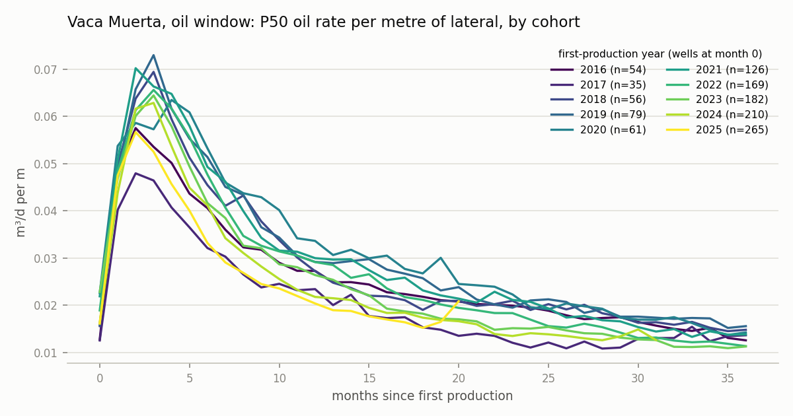
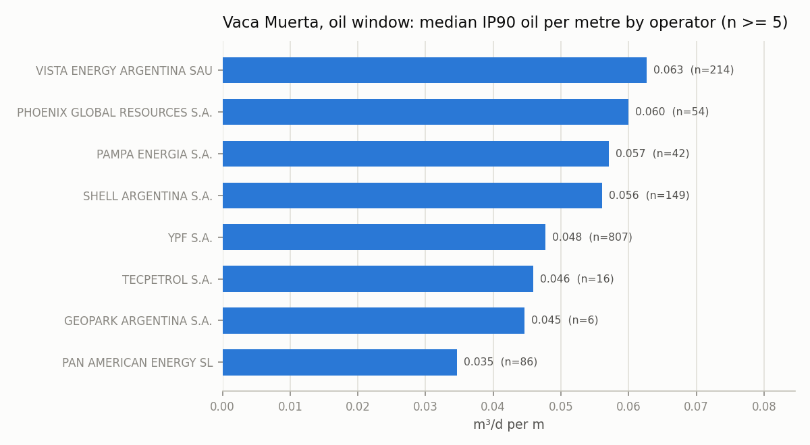
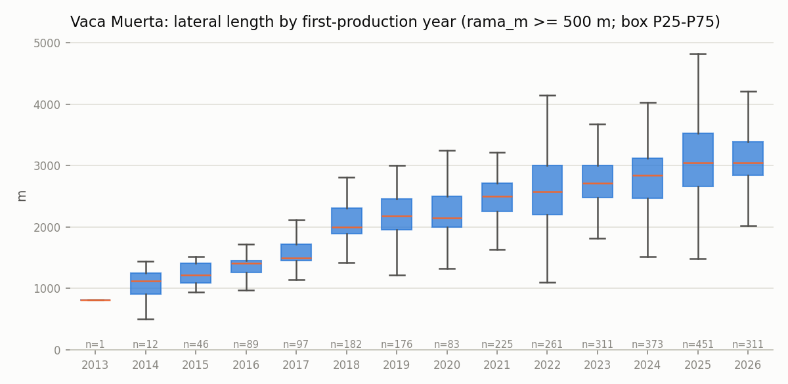
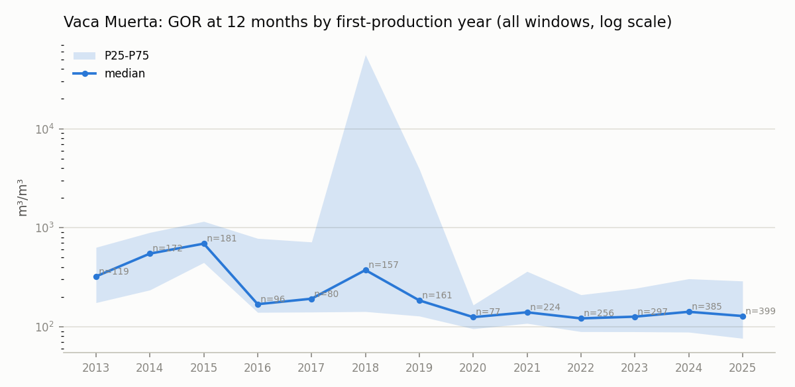

# Indicators and type curves report — 2026-10-31

Phase 2 of the observatory: *per-well indicators with lineage, type curves by cohort, outliers marked*. Built by `vma/indicadores.py` and `vma/curvas.py` from the master `data/publicado/2026-10-31/pozos.parquet` and the raw production of `data/raw/2026-10-30/`, published as `data/publicado/2026-10-31/indicadores.{csv,parquet}` and `curvas_tipo.{csv,parquet}` (not versioned; rebuild with `python pipeline.py indicadores` and `python pipeline.py curvas`). Column definitions, formulas and rules: [`docs/indicadores.md`](../docs/indicadores.md). Decisions: ADR-015 to ADR-019 in [`docs/decisiones.md`](../docs/decisiones.md).

Scope (ADR-002): `cuenca = NEUQUINA` and `tipo_recurso = NO CONVENCIONAL` → **4,751** of 5,750 master wells (`en_alcance`); the other 999 stay in the table with `fuera_alcance` and no outlier screening. 4,625 in-scope wells have a first production month (the rest: `sin_produccion` / `nunca_produjo`).

## 1. Coverage: how many in-scope wells have each indicator

| indicator | wells | % of producing |
|---|---|---|
| `ip30_*` (needs >= 30 producing days) | 4,576 | 98.9 |
| `ip90_*` (needs >= 90 producing days) | 4,437 | 95.9 |
| `ip180_*` (needs >= 180 producing days) | 4,265 | 92.2 |
| `acum6_*` (needs 6 months of history) | 4,384 | 94.8 |
| `acum12_*` (needs 12 months of history) | 4,150 | 89.7 |
| `acum24_*` (needs 24 months of history) | 3,689 | 79.8 |
| per-metre values (`rama_normalizable`: rama_m >= 500 m) | 2,689 | 58.1 |
| `ip90_*_por_m` | 2,595 | 56.1 |
| `acum12_*_por_m` | 2,310 | 49.9 |
| `gor12_m3_m3` (oil > 0 in the first 12 months) | 3,599 | 77.8 |
| `ventana` (fluid window from GOR; `ventana_provisoria` when not from GOR12) | 4,625 | 100.0 |
| `corte_agua12` | 4,123 | 89.1 |

Why per-metre values are null (in-scope wells, one reason per well):

| flag | wells |
|---|---|
| `sin_rama_sin_fractura` | 1,001 |
| `sin_rama_faltante` | 178 |
| `sin_rama_cero` | 856 |
| `sin_rama` | 0 |
| `rama_corta` | 27 |

Effective-days anomalies handled by rule (in-scope wells with at least one such month):

| flag | wells |
|---|---|
| `tef_cero_con_produccion` (production with 0 days → whole month assumed) | 129 |
| `tef_mayor_mes` (more days than the month → capped) | 52 |
| `primer_mes_parcial` (first month with < 15 producing days) | 2,147 |
| `produccion_suma_idpozo` (two or more idpozo summed in one month) | 164 |
| `volumen_negativo` | 1 |
| `acum12_meses_faltantes` (gap months counted as zero) | 52 |

## 2. Medians by formation (in-scope, outliers excluded from the per-metre columns)

| formacion | wells | with ip90/m | median rama_m | median etapas/100 m | median IP90 eq (m³/d) | median IP90 eq per m | median acum12 eq per m (m³/m) | median GOR12 (m³/m³) | median water cut 12 |
|---|---|---|---|---|---|---|---|---|---|
| Vaca Muerta | 3,425 | 2,519 | 2,576 | 1.594 | 136.300 | 0.061 | 18.120 | 171.791 | 0.350 |
| Lajas | 559 | 1 | 833 | 1.681 | 72.357 | 0.154 | 38.559 | 6,354.633 | 0.968 |
| Mulichinco | 242 | 56 | 1,003 | 0.787 | 76.929 | 0.129 | 29.675 | 61,855.964 | 0.746 |
| Los Molles | 195 | 0 |  |  | 38.511 |  |  | 36,885.093 | 0.645 |
| Punta Rosada | 105 | 0 |  |  | 238.162 |  |  | 10,536.104 | 0.641 |
| Precuyo | 69 | 0 | 76 |  | 65.606 |  |  | 13,030.307 | 0.691 |
| Agrio | 60 | 1 | 1,504 | 1.263 | 167.808 | 0.037 | 7.368 | 3,072,870.380 | 0.998 |
| Quintuco | 27 | 1 | 3,886 | 1.853 | 35.885 | 0.054 |  | 9,480.136 | 0.499 |

## 3. Vaca Muerta by cohort (first-production year; outliers excluded)

| cohorte | wells | with ip90/m | median rama_m | median etapas/100 m | median IP90 eq per m | median IP90 oil per m | median acum12 eq per m | median GOR12 | % gas window |
|---|---|---|---|---|---|---|---|---|---|
| 2012 | 45 | 4 | 856 | 1.116 | 0.028 | 0.019 | 7.180 | 385.175 | 13 |
| 2013 | 120 | 1 | 422 | 1.227 | 0.025 | 0.018 | 5.555 | 322.164 | 6 |
| 2014 | 174 | 12 | 1,122 | 1.245 | 0.054 | 0.035 | 14.798 | 547.664 | 9 |
| 2015 | 191 | 46 | 1,206 | 1.276 | 0.064 | 0.041 | 15.133 | 690.372 | 12 |
| 2016 | 112 | 89 | 1,409 | 1.272 | 0.054 | 0.040 | 16.547 | 168.875 | 29 |
| 2017 | 101 | 96 | 1,500 | 1.278 | 0.050 | 0.030 | 16.077 | 191.805 | 39 |
| 2018 | 183 | 177 | 2,000 | 1.282 | 0.074 | 0.014 | 25.100 | 449.403 | 54 |
| 2019 | 180 | 169 | 2,178 | 1.382 | 0.065 | 0.037 | 21.117 | 180.682 | 38 |
| 2020 | 88 | 83 | 2,150 | 1.566 | 0.061 | 0.051 | 19.178 | 124.973 | 16 |
| 2021 | 259 | 224 | 2,500 | 1.515 | 0.065 | 0.046 | 20.801 | 140.133 | 29 |
| 2022 | 287 | 260 | 2,579 | 1.557 | 0.066 | 0.041 | 19.512 | 121.366 | 28 |
| 2023 | 331 | 311 | 2,708 | 1.655 | 0.063 | 0.041 | 18.382 | 126.339 | 27 |
| 2024 | 403 | 370 | 2,835 | 1.651 | 0.059 | 0.041 | 16.538 | 141.302 | 17 |
| 2025 | 467 | 446 | 3,042 | 1.654 | 0.056 | 0.043 | 15.751 | 128.582 | 14 |
| 2026 | 403 | 231 | 3,040 | 1.666 | 0.061 | 0.043 |  |  | 17 |

The 2018 cohort stands out because most of its wells are in the gas window (`ventana`, ADR-020): oil-equivalent per metre is not comparable across windows, which is why the rankings below are split by window.

## 4. Operators by IP90 per metre, Vaca Muerta (median, n >= 5, outliers excluded, split by fluid window)

`ventana = petroleo` (1,377 wells with the indicator):

| operadora | n | median IP90 (oil, m³/d per m) | median rama_m | median cohort |
|---|---|---|---|---|
| VISTA ENERGY ARGENTINA SAU | 214 | 0.063 | 2,818 | 2024 |
| PHOENIX GLOBAL RESOURCES S.A. | 54 | 0.060 | 2,746 | 2024 |
| PAMPA ENERGIA S.A. | 42 | 0.057 | 2,505 | 2025 |
| SHELL ARGENTINA S.A. | 149 | 0.056 | 2,625 | 2022 |
| YPF S.A. | 807 | 0.048 | 2,484 | 2022 |
| TECPETROL S.A. | 16 | 0.046 | 3,440 | 2025 |
| GEOPARK ARGENTINA S.A. | 6 | 0.045 | 2,520 | 2024 |
| PAN AMERICAN ENERGY SL | 86 | 0.035 | 3,023 | 2024 |

`ventana = gas` (609 wells with the indicator):

| operadora | n | median IP90 (gas, thousand m³/d per m) | median rama_m | median cohort |
|---|---|---|---|---|
| PAMPA ENERGIA S.A. | 44 | 0.156 | 2,505 | 2023 |
| PAN AMERICAN ENERGY SL | 67 | 0.151 | 2,800 | 2023 |
| TECPETROL S.A. | 132 | 0.143 | 2,524 | 2019 |
| TOTAL AUSTRAL S.A. | 88 | 0.114 | 2,785 | 2022 |
| PLUSPETROL S.A. | 83 | 0.098 | 3,015 | 2024 |
| YPF S.A. | 184 | 0.066 | 2,017 | 2019 |
| VACA MUERTA INVERSIONES SAU | 6 | 0.065 | 1,545 | 2016 |
| PLUSPETROL CUENCA NEUQUINA S.R.L. | 5 | 0.038 | 3,295 | 2019 |

Read with care: the window is itself derived from the well's GOR (ADR-020), landing levels are not published by the source, and cohorts differ (`median cohort`). It is a comparison of the published data, not of operators' skill.

## 5. Outliers

Rule (ADR-018): within each formation, robust z = (log10(`ip90_equivalente_m3_d_por_m`) − median) / (1.4826 · MAD); |z| > 3.5 is an outlier; formations with fewer than 20 evaluable wells are not screened. 2,592 in-scope wells were screened, **17 marked** (0 high, 17 low); 2,159 could not be (no IP90 per metre, or a small formation). They stay in `indicadores` with `outlier_ip90_m = True` and are excluded only from the `incluye_outliers = False` type curves.

| formacion | outliers | high | low | min_rama | median_rama |
|---|---|---|---|---|---|
| Vaca Muerta | 17 | 0 | 17 | 1,587 | 2,520 |

The most extreme ten (what they look like, so the rule can be judged):

| sigla | operadora | formacion | cohorte | rama_m | etapas | ip90_equivalente_m3_d | ip90_equivalente_m3_d_por_m | outlier_z_ip90_m | dias_efectivos_total |
|---|---|---|---|---|---|---|---|---|---|
| PAE.Nq.BCeCg-110(h) | PAN AMERICAN ENERGY SL | Vaca Muerta | 2,018 | 2,000 | 27 | 0.099 | 0.000 | -13.997 | 2,955.494 |
| YPF.Nq.LRi-20(h) | YPF S.A. | Vaca Muerta | 2,019 | 2,249 | 28 | 1.033 | 0.000 | -9.609 | 1,395.180 |
| YPF.Nq.LRi-18(h) | YPF S.A. | Vaca Muerta | 2,019 | 2,196 | 22 | 1.033 | 0.000 | -9.563 | 1,592.400 |
| YPF.Nq.LRi-19(h) | YPF S.A. | Vaca Muerta | 2,019 | 1,914 | 22 | 1.033 | 0.001 | -9.291 | 1,750.370 |
| KILW.NqN.MMo x-1001(h) | PHOENIX GLOBAL RESOURCES S.A. | Vaca Muerta | 2,018 | 1,587 | 40 | 5.652 | 0.004 | -5.575 | 2,480.564 |
| YPF.Nq.LCav-200(h) | YPF S.A. | Vaca Muerta | 2,024 | 2,922 | 22 | 10.804 | 0.004 | -5.501 | 189.680 |
| SHE.Nq.CASO-26(h) | SHELL ARGENTINA S.A. | Vaca Muerta | 2,024 | 2,520 | 43 | 11.377 | 0.005 | -5.107 | 825.010 |
| PAE.Nq.BCeCg-112(h) | PAN AMERICAN ENERGY SL | Vaca Muerta | 2,018 | 2,000 | 60 | 10.237 | 0.005 | -4.860 | 2,813.435 |
| TPT.Nq.PPar-265(h) | TECPETROL S.A. | Vaca Muerta | 2,025 | 3,582 | 5 | 19.387 | 0.005 | -4.750 | 548.436 |
| TAU.Nq.SR-1013(h) | TOTAL AUSTRAL S.A. | Vaca Muerta | 2,019 | 2,250 | 23 | 12.469 | 0.006 | -4.704 | 1,414.203 |

What the rule caught: 11 of the 17 have an IP90 under 20 m³/d of oil equivalent (wells that barely flowed in their first 90 producing days: tests, early shut-ins, or volumes reported under another idpozo) and 0 have a lateral under 1,000 m (a short or mis-loaded `rama_m` inflates every per-metre value). They are marked, not fixed: a reader can look at them in `indicadores` and decide.

## 6. Type curves

| level | groups | groups with >= 5 wells at month 0 | rows (with and without outliers) |
|---|---|---|---|
| cohorte_formacion | 129 | 68 | 33,570 |
| cohorte_formacion_operadora | 372 | 161 | 75,196 |
| cohorte_formacion_ventana | 179 | 102 | 42,646 |

Vaca Muerta × cohort, month 0 and month 12 (`incluye_outliers = True`):

| cohorte | n wells month 0 | n with rama | P50 eq rate month 0 (m³/d) | P50 eq per m month 0 | P50 eq per m month 12 | n at month 12 |
|---|---|---|---|---|---|---|
| 2012 | 45 | 4 | 18.628 |  |  | 38 |
| 2013 | 120 | 1 | 16.272 |  |  | 107 |
| 2014 | 174 | 12 | 12.829 | 0.014 | 0.031 | 165 |
| 2015 | 191 | 46 | 15.274 | 0.027 | 0.026 | 181 |
| 2016 | 112 | 89 | 15.523 | 0.010 | 0.030 | 108 |
| 2017 | 101 | 97 | 13.495 | 0.008 | 0.035 | 95 |
| 2018 | 186 | 182 | 37.954 | 0.019 | 0.058 | 172 |
| 2019 | 184 | 176 | 42.635 | 0.023 | 0.047 | 166 |
| 2020 | 88 | 83 | 42.627 | 0.026 | 0.041 | 87 |
| 2021 | 260 | 225 | 67.515 | 0.027 | 0.041 | 249 |
| 2022 | 287 | 261 | 62.603 | 0.026 | 0.040 | 277 |
| 2023 | 331 | 311 | 68.745 | 0.027 | 0.036 | 320 |
| 2024 | 406 | 373 | 60.376 | 0.022 | 0.030 | 402 |
| 2025 | 470 | 451 | 58.717 | 0.020 | 0.029 | 356 |
| 2026 | 406 | 311 | 53.581 | 0.016 |  |  |

## 7. Flags

Every rule that fired, counted over the whole indicators table (definitions in `docs/indicadores.md`):

| flag | wells | % |
|---|---|---|
| outlier_no_evaluado | 3,158 | 54.9 |
| primer_mes_parcial | 2,256 | 39.2 |
| sin_rama_cero | 1,637 | 28.5 |
| sin_rama_sin_fractura | 1,037 | 18.0 |
| fuera_alcance | 999 | 17.4 |
| acum24_historia_corta | 940 | 16.3 |
| sin_produccion | 772 | 13.4 |
| gor6_sin_petroleo | 645 | 11.2 |
| gor12_sin_petroleo | 556 | 9.7 |
| ventana_provisoria | 475 | 8.3 |
| acum12_historia_corta | 475 | 8.3 |
| ip180_dias_insuficientes | 361 | 6.3 |
| acum6_historia_corta | 241 | 4.2 |
| sin_rama_faltante | 196 | 3.4 |
| ip90_dias_insuficientes | 189 | 3.3 |
| rama_corta | 168 | 2.9 |
| produccion_suma_idpozo | 164 | 2.9 |
| nunca_produjo | 142 | 2.5 |
| tef_cero_con_produccion | 129 | 2.2 |
| acum24_meses_faltantes | 93 | 1.6 |
| tef_mayor_mes | 52 | 0.9 |
| acum12_meses_faltantes | 52 | 0.9 |
| ip30_dias_insuficientes | 49 | 0.9 |
| corte_agua6_sin_liquido | 29 | 0.5 |
| corte_agua12_sin_liquido | 28 | 0.5 |
| outlier_ip90_m_bajo | 17 | 0.3 |
| acum6_meses_faltantes | 11 | 0.2 |
| volumen_negativo | 2 | 0.0 |

Production months used: 408,328 well-months, last month in the file `2026-09`.
