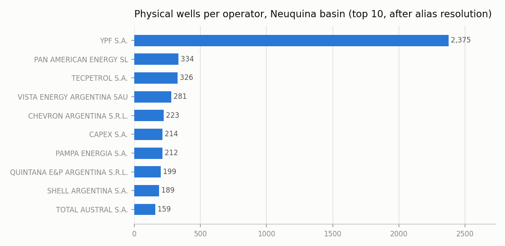
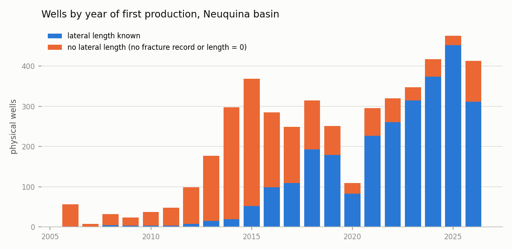
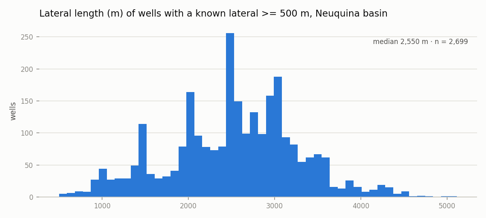

# Well master report — 2026-10-31

Phase 1 of the observatory: *one row per physical well*. Built by `vma/master.py` from the raw download of `2026-10-30` (`data/raw/2026-10-30/`), published as `data/publicado/2026-10-31/pozos.csv` and `data/publicado/2026-10-31/pozos.parquet` (not versioned; rebuild with `python pipeline.py master`). Column definitions and rules: [`docs/maestro.md`](../docs/maestro.md). Decisions: ADR-010 to ADR-014 in [`docs/decisiones.md`](../docs/decisiones.md).

## 1. Identity

| measure | value |
|---|---|
| idpozo in scope (production ∪ fracture) | 5,960 |
| physical wells (sigla at level L2) | 5,750 |
| idpozo collapsed into another idpozo's well | 210 |
| wells with more than one idpozo | 189 |
| of which with more than one formation | 188 |
| wells whose sigla has more than one raw spelling | 1 |
| sigla spellings added to alias/siglas.csv this run | 0 |
| operator names merged into another (alias/operadoras.csv) | 6 |
| formation names merged into another (alias/formaciones.csv) | 0 |
| wells with an operator not in the alias table | 0 |
| wells that changed operator in the production history | 714 |
| wells not in the register (pozos) | 0 |

Physical wells by basin and resource type:

| cuenca | tipo_recurso | physical wells |
|---|---|---|
| NEUQUINA | NO CONVENCIONAL | 4,751 |
| GOLFO SAN JORGE | CONVENCIONAL | 447 |
| NEUQUINA | CONVENCIONAL | 288 |
| AUSTRAL | NO CONVENCIONAL | 209 |
| GOLFO SAN JORGE | NO CONVENCIONAL | 15 |
| GOLFO SAN JORGE | No informado | 15 |
| NEUQUINA | No informado | 10 |
| AUSTRAL | CONVENCIONAL | 7 |
| AUSTRAL | No informado | 4 |
| NOROESTE | NO CONVENCIONAL | 3 |
| NEUQUINA | NO DISCRIMINADO | 1 |

## 2. Coordinates, depth, dates

| rule | wells |
|---|---|
| longitude/latitude swapped -> corrected | 1 |
| outside basin or country bounding box (kept, flagged) | 0 |
| no coordinates | 0 |
| idpozo of the same well with different points | 28 |
| depth = 0 -> null | 175 |
| depth > 8,000 m (kept, flagged) | 4 |
| drilling/completion date before 1950 -> null (placeholder) | 65 |
| no drilling start date (empty or placeholder) | 95 |
| completion starts before drilling ends | 1 |

## 3. First production: computed vs. padrón

The padrón publishes a first-production month per `idpozo`; the master computes it as the first month with oil or gas > 0 in the production file. Of 4,810 wells with both values, 557 agree on the month, 4,454 agree on the year, and 4,485 padrón dates fall in January: the padrón is, in practice, a year of first production, not a month. The master keeps both columns.

## 4. Fracture: lateral length and stages (Neuquina)

| measure | value |
|---|---|
| physical wells, Neuquina | 5,050 |
| with a fracture record | 4,049 |
| without any fracture record | 1,001 |
| with lateral length > 0 | 2,735 |
| fracture record but all lengths = 0 | 1,314 |
| of which with >= 10 stages (`rama_faltante`: horizontal well, length missing) | 181 |
| with several records and different lengths > 0 (`rama_multiple`, max kept) | 22 |
| with more than one fracture record | 106 |
| median lateral length, wells >= 500 m (m) | 2,550 |
| median stages, wells with lateral >= 500 m | 41 |

## 5. Distribution by operator and formation (Neuquina, top 10)

| operadora | physical wells | with lateral length | producing |
|---|---|---|---|
| YPF S.A. | 2,375 | 1,410 | 2,339 |
| PAN AMERICAN ENERGY SL | 334 | 181 | 327 |
| TECPETROL S.A. | 326 | 164 | 249 |
| VISTA ENERGY ARGENTINA SAU | 281 | 227 | 271 |
| CHEVRON ARGENTINA S.R.L. | 223 | 47 | 51 |
| CAPEX S.A. | 214 | 1 | 158 |
| PAMPA ENERGIA S.A. | 212 | 103 | 202 |
| QUINTANA E&P ARGENTINA S.R.L. | 199 | 0 | 190 |
| SHELL ARGENTINA S.A. | 189 | 180 | 186 |
| TOTAL AUSTRAL S.A. | 159 | 138 | 147 |

| formacion_principal | physical wells | median lateral (m) |
|---|---|---|
| Vaca Muerta | 3,443 | 2,576 |
| Lajas | 587 | 833 |
| Mulichinco | 251 | 1,003 |
| Los Molles | 228 |  |
| Huitrín | 146 |  |
| Punta Rosada | 111 |  |
| Precuyo | 86 | 73 |
| Agrio | 75 | 1,504 |
| Quintuco | 32 | 2,420 |
| Lotena | 25 |  |

## 6. Flags

Every rule that fired, counted over the whole master (a well can carry several flags; definitions in `docs/maestro.md`):

| flag | wells | % |
|---|---|---|
| primera_produccion_difiere_padron | 4,253 | 74.0 |
| rama_cero | 1,833 | 31.9 |
| sin_fractura | 1,037 | 18.0 |
| sin_produccion | 772 | 13.4 |
| cambio_operadora | 714 | 12.4 |
| fractura_multiples_registros | 219 | 3.8 |
| rama_faltante | 196 | 3.4 |
| multi_idpozo | 189 | 3.3 |
| multi_formacion | 188 | 3.3 |
| profundidad_cero | 175 | 3.0 |
| nunca_produjo | 142 | 2.5 |
| fecha_placeholder | 65 | 1.1 |
| sin_padron_primera_produccion | 37 | 0.6 |
| rama_multiple | 32 | 0.6 |
| coordenadas_multiples | 28 | 0.5 |
| tipo_recurso_mixto | 19 | 0.3 |
| profundidad_multiple | 7 | 0.1 |
| profundidad_sospechosa | 4 | 0.1 |
| fractura_fecha_futura | 2 | 0.0 |
| coordenadas_invertidas | 1 | 0.0 |
| fechas_inconsistentes | 1 | 0.0 |
| area_multiple | 1 | 0.0 |
| yacimiento_multiple | 1 | 0.0 |
| terminacion_antes_de_perforar | 1 | 0.0 |

## 7. Inputs

| key | bytes | sha256 | CKAN last_modified |
|---|---|---|---|
| fractura | 1,254,362 | af87ed4dfe35… | 2026-10-30 |
| listado_pozos_operadoras | 27,071,868 | 7ef1c43bf490… | 2025-10-20 |
| padron_pozos | 1,171,351 | fc99e349313b… | 2026-10-10 |
| pozos | 34,216,363 | a8a7c757a616… | 2026-10-21 |
| pozos_en_perforacion | 68,256,503 | 2a60a9044b52… | 2026-10-20 |
| pozos_terminados | 191,872,641 | 8eb684fa9253… | 2026-10-24 |
| produccion_nc | 148,923,474 | 61cecc31c8dd… | 2026-10-22 |

Alias tables version: `2026-10-31` (max `desde` across `alias/*.csv`).
